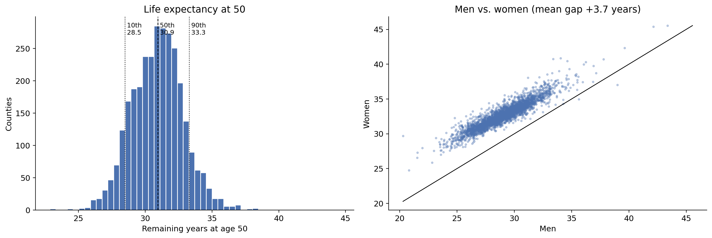
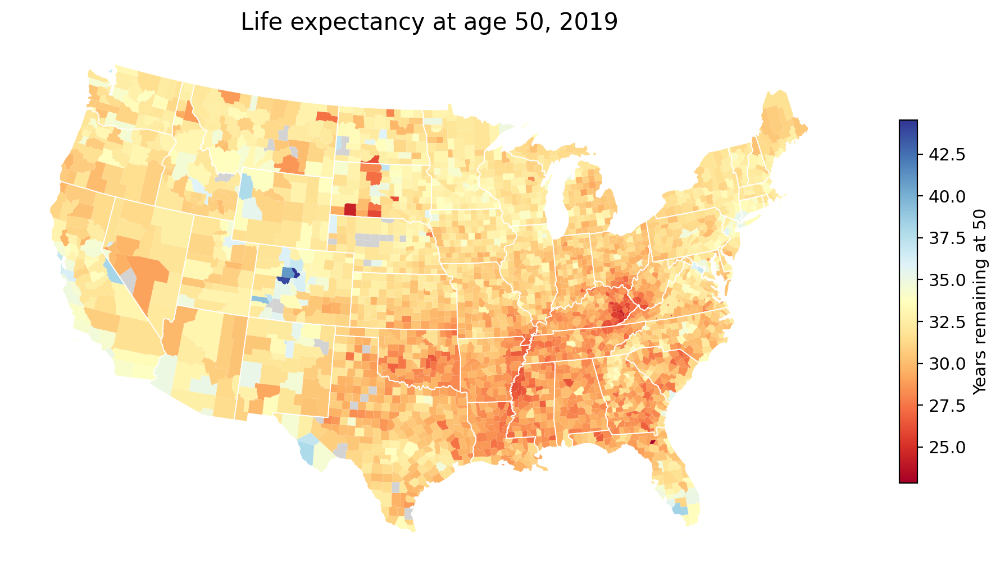
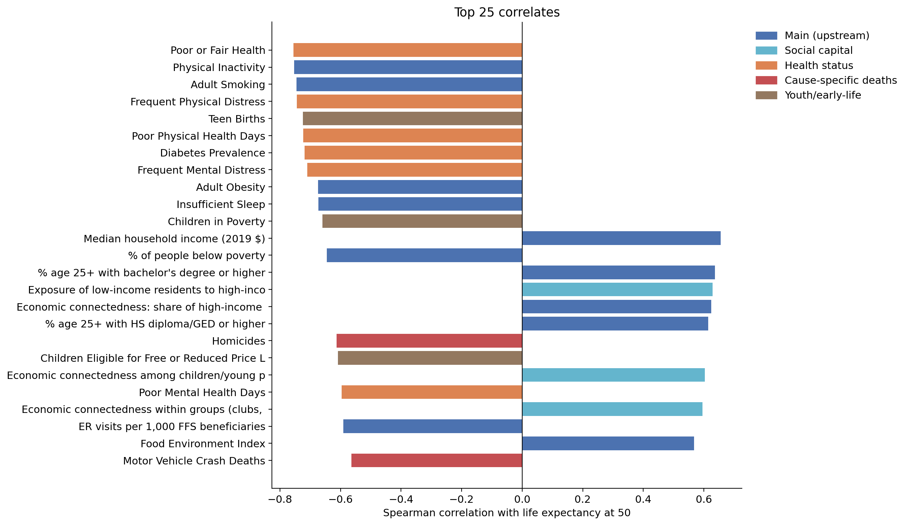
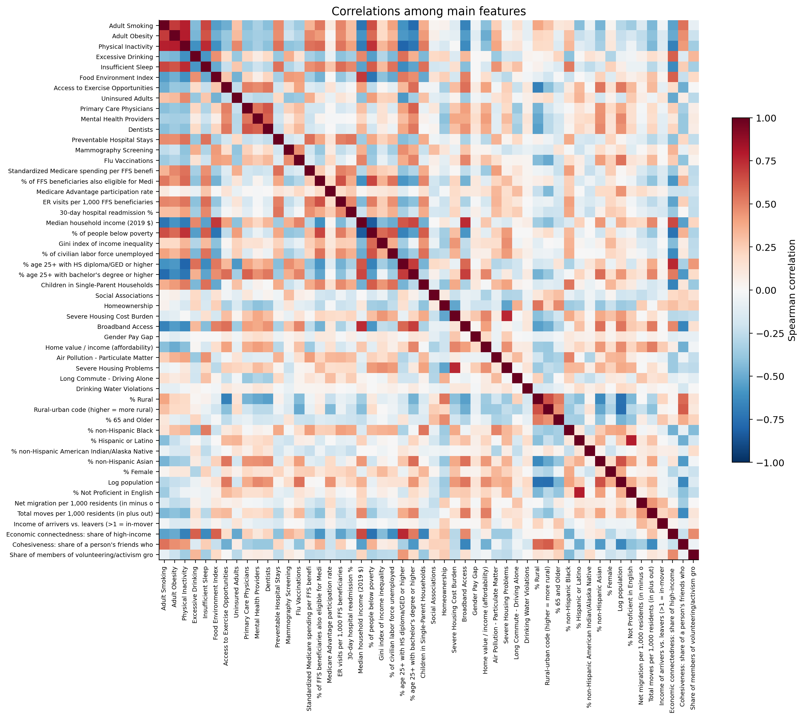
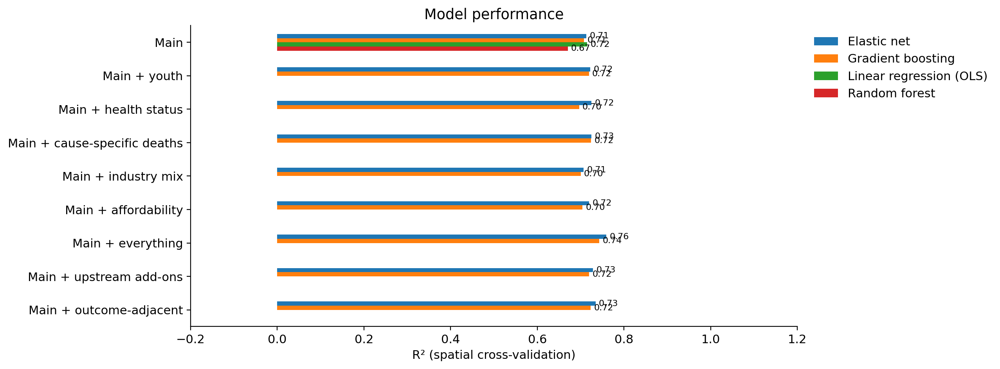
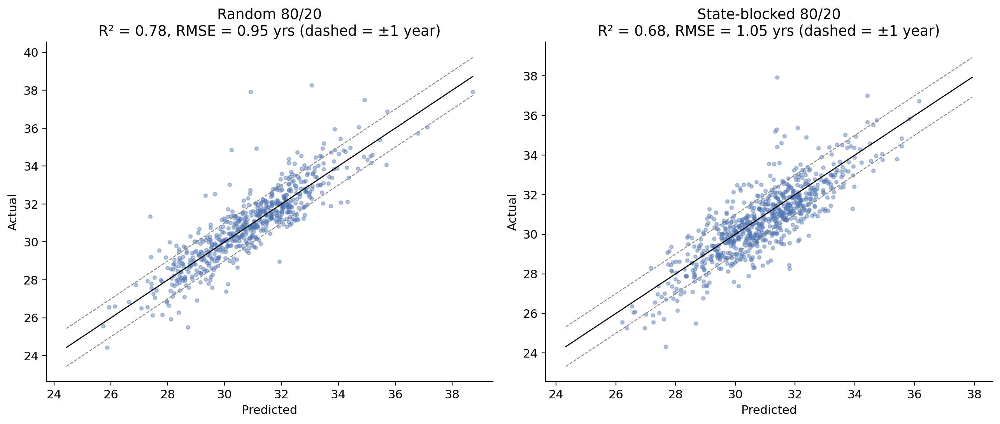
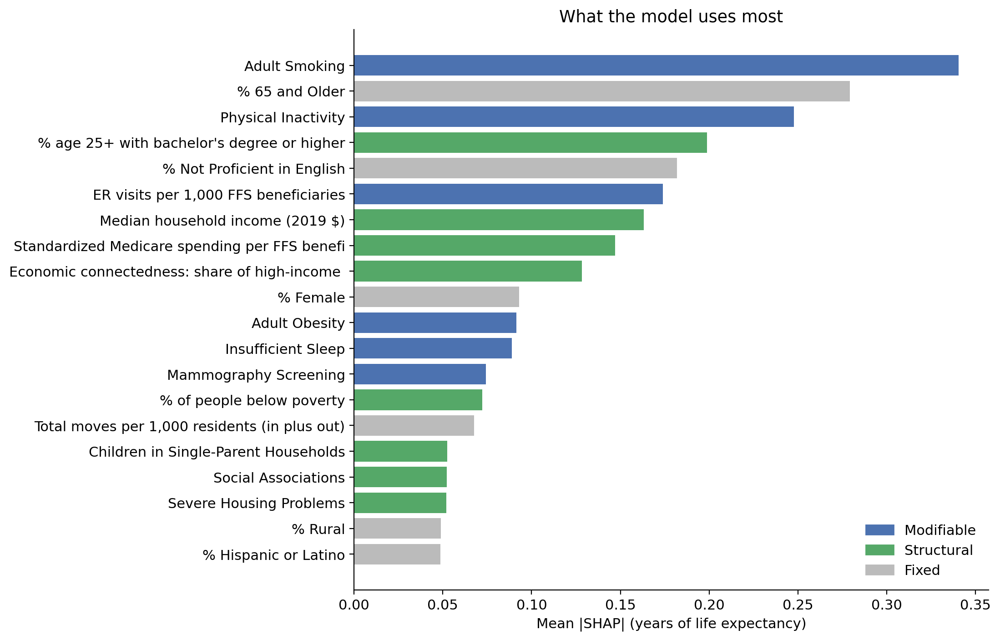
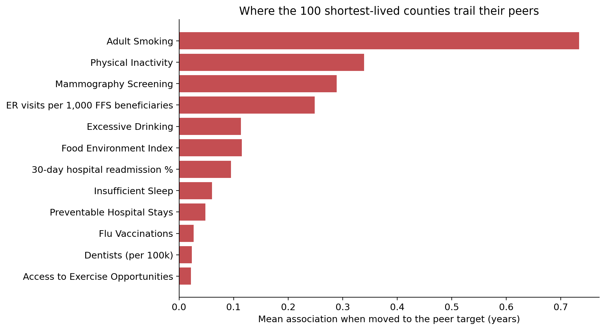
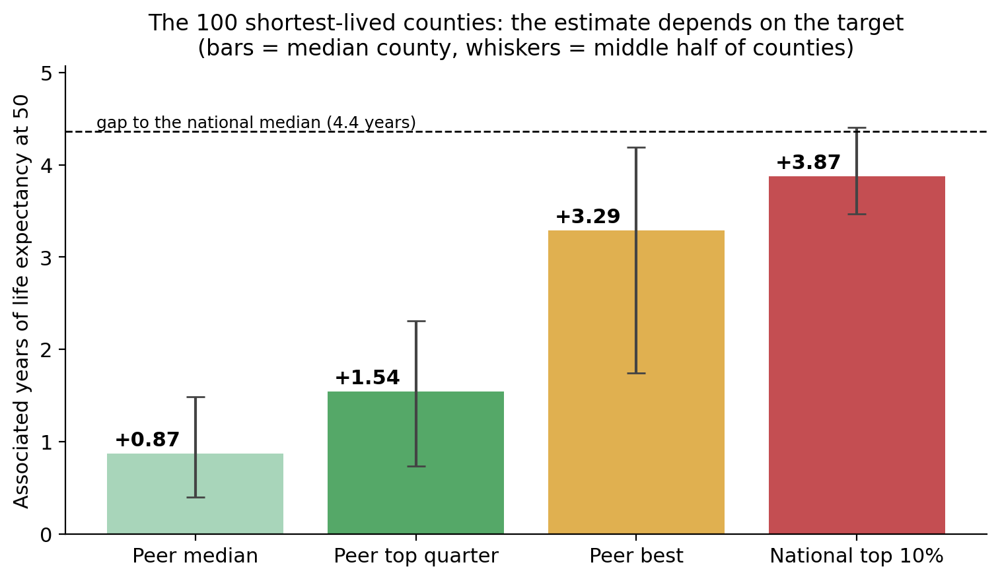
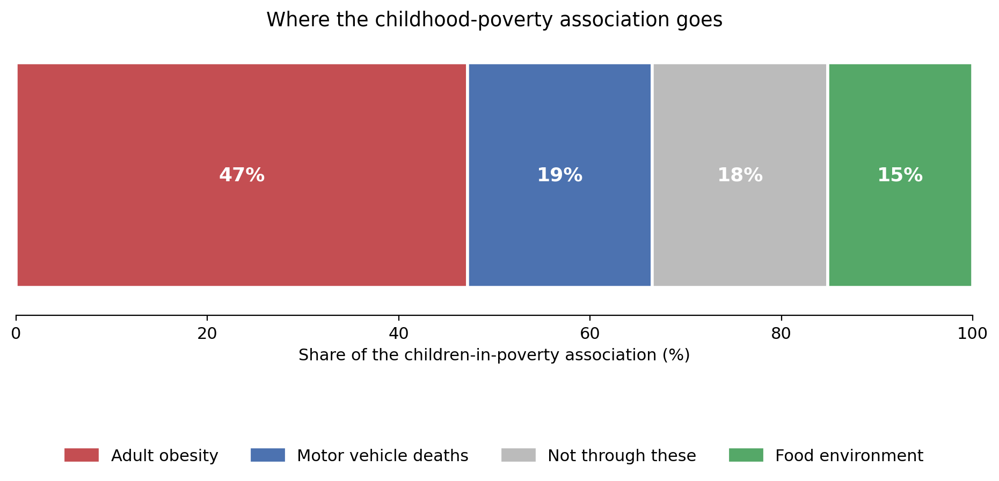

# Life After 50: What Shapes How Long People Live in Each U.S. County

**Michael Tyler**
**Fall 2026**

Prepared for UMBC Data Science Master Degree Capstone by Dr. Chaojie (Jay) Wang

| | |
|---|---|
| **GitHub repository** | https://github.com/frogmantic/UMBC-DATA606-Capstone |
| **PowerPoint presentation** | [docs/MichaelTylerData606Update.pptx](https://github.com/frogmantic/UMBC-DATA606-Capstone/blob/main/docs/MichaelTylerData606Update.pptx) |
| **YouTube video** | https://youtu.be/bjJq8PddmbE |
| **Web app** | https://life-expectancy-after-50.streamlit.app/ |

---

## Contents

- [2. Background](#2-background)
- [3. Data](#3-data)
- [4. Exploratory Data Analysis](#4-exploratory-data-analysis)
- [5. Model Training and Results](#5-model-training-and-results)
- [6. Application of the Trained Models](#6-application-of-the-trained-models)
- [7. Conclusion](#7-conclusion)
- [8. References](#8-references)

---

## 2. Background

### What is it about?

A 50 year old in the longest-lived U.S. county can expect to live more than 20 years longer than a 50 year old in the shortest-lived one. This project asks why. It builds one dataset of 3,079 counties from eight public sources, models life expectancy at age 50, and turns the model into something a county can use: a page showing where it stands, what it trails similar counties on, and how many years that gap is associated with.

Most work on county life expectancy uses life expectancy at birth. That measure is pulled down by infant deaths, accidents and violence among the young. Life expectancy at 50 leaves those out and looks at the part of life where chronic disease, behavior and access to care decide the outcome.

### Why does it matter?

- **The gap is large and it is local.** The middle 80% of counties span 4.8 years, and the full range is more than 20.
- **Counties need to know what is within reach.** A ranking tells a county it is doing badly. It does not say whether the reason is who lives there, the local economy, or something a health department could change.
- **Comparisons are usually unfair.** Comparing a poor rural county with a wealthy suburb says little. Comparing it with the 25 counties most like it says a lot.

### Research questions

1. How well can a county's characteristics predict life expectancy at age 50?
2. Which characteristics matter most, and how much of what matters is something a county could change?
3. For a given county, what could it change, and how many years of life is that associated with?
4. Childhood poverty tracks strongly with how long 50 year olds live. What does that link run through?

---

## 3. Data

### Data sources

Eight public sources were loaded and joined on county FIPS code. Seven feed the final model. The eighth was tested and not kept.

| # | Source | What it provides | Year | In the model |
|---|---|---|---|---|
| 1 | [IHME U.S. Life Expectancy by County](https://ghdx.healthdata.org/) | Life expectancy by county, age and sex. This is the outcome. | 2019 | Target |
| 2 | [County Health Rankings](https://www.countyhealthrankings.org/) | Health behaviors, clinical care, social and physical environment | 2023 release | 28 features |
| 3 | [Census American Community Survey](https://www.census.gov/programs-surveys/acs) | Income, poverty, education, race and ethnicity | 2015 to 2019 | 11 features |
| 4 | [USDA Rural-Urban Continuum Codes](https://www.ers.usda.gov/data-products/rural-urban-continuum-codes/) | How urban or rural each county is | 2013 | 1 feature |
| 5 | [CMS Medicare Geographic Variation](https://data.cms.gov/) | Medicare spending and use | 2019 | 5 features |
| 6 | [IRS SOI County Migration](https://www.irs.gov/statistics/soi-tax-stats-migration-data) | Tax filers moving in and out | 2018 to 2019 | 3 features |
| 7 | [Opportunity Insights Social Capital Atlas](https://socialcapital.org/) | Friendship patterns across income levels, volunteering | 2022 release | 3 features |
| 8 | [BLS Quarterly Census of Employment and Wages](https://www.bls.gov/cew/) | Jobs and wages by industry | 2019 | Tested, not kept |

### Data size

| | Size |
|---|---|
| Raw files, all eight sources | about 1.4 GB |
| Largest raw files | IHME life tables (15 files, 690 MB) and BLS employment (512 MB) |
| Final analysis file, `county_le50_2019.csv` | 5.3 MB |

### Data shape

The final analysis file has **3,079 rows and 150 columns**. The main model uses 51 of those columns as features.

### Time period

The outcome is life expectancy in **2019**. Predictors were chosen to describe the years just before it, mostly 2015 to 2019. County Health Rankings is the exception: its 2023 release draws on several data years on either side of 2019. This is listed under limitations.

### What does each row represent?

**Each row is one U.S. county.** The 50 states and the District of Columbia are covered.

Two adjustments were needed to make that true across all eight sources:

- **Combined counties.** IHME reports 54 counties as 22 combined units, mostly Virginia independent cities joined to the county around them. Those counties were combined the same way in every other source, using population weights.
- **Retired county codes.** Counties that were renamed or merged, such as Shannon County, South Dakota becoming Oglala Lakota County, were mapped to their current code. Seven retired codes with no Census data were dropped.

### Target variable

**`le50_both`**: remaining life expectancy at age 50 for both sexes combined, in years. A value of 30.9 means a 50 year old can expect to live to about 81. Across counties it averages 30.9 years and ranges from 22.9 to 44.5.

Three related columns are kept for reporting and are never used as predictors: `le50_male`, `le50_female` and `le0_both` (life expectancy at birth).

### Data dictionary

**Identifying columns**

| Column | Type | Definition | Values |
|---|---|---|---|
| `fips` | text | 5-digit county code. The first two digits are the state. | `01001` to `56045` |
| `county_name` | text | County name | |
| `state` | text | State postal abbreviation | 51 values |
| `census_division` | categorical | Census Bureau division, used to block cross-validation | 9 divisions, New England to Pacific |
| `member_fips` | text | The counties in the row, separated by `;` when IHME combines them | |
| `le50_both` | float | **Target.** Remaining life expectancy at age 50, both sexes | 22.9 to 44.5 years |

**The 51 model features**

Each feature is placed in one of three categories. The category decides how it is used later.

- **Modifiable (18):** a county could act on it through policy or programs.
- **Structural (20):** it moves over years, not through one program.
- **Fixed (13):** a county cannot change it. These are used to find comparable counties.

| Column | Type | Definition | Values | Source | Category |
|---|---|---|---|---|---|
| `chr_adult_smoking` | float | Adults who currently smoke | share, 0 to 1 | County Health Rankings | Modifiable |
| `chr_adult_obesity` | float | Adults with a body mass index of 30 or more | share, 0 to 1 | County Health Rankings | Modifiable |
| `chr_physical_inactivity` | float | Adults reporting no leisure-time physical activity | share, 0 to 1 | County Health Rankings | Modifiable |
| `chr_excessive_drinking` | float | Adults reporting binge or heavy drinking | share, 0 to 1 | County Health Rankings | Modifiable |
| `chr_insufficient_sleep` | float | Adults sleeping fewer than 7 hours a night | share, 0 to 1 | County Health Rankings | Modifiable |
| `chr_food_environment_index` | float | Index of access to healthy food and food security | 0 (worst) to 10 (best) | County Health Rankings | Modifiable |
| `chr_access_to_exercise_opportunities` | float | Residents living close to a park or recreation facility | share, 0 to 1 | County Health Rankings | Modifiable |
| `chr_uninsured_adults` | float | Adults under 65 without health insurance | share, 0 to 1 | County Health Rankings | Modifiable |
| `chr_primary_care_physicians` | float | Primary care physicians per 100,000 residents | rate | County Health Rankings | Modifiable |
| `chr_mental_health_providers` | float | Mental health providers per 100,000 residents | rate | County Health Rankings | Modifiable |
| `chr_dentists` | float | Dentists per 100,000 residents | rate | County Health Rankings | Modifiable |
| `chr_preventable_hospital_stays` | float | Hospital stays for conditions treatable in outpatient care, per 100,000 Medicare enrollees | rate | County Health Rankings | Modifiable |
| `chr_mammography_screening` | float | Female Medicare enrollees aged 65 to 74 with an annual mammogram | share, 0 to 1 | County Health Rankings | Modifiable |
| `chr_flu_vaccinations` | float | Medicare enrollees with an annual flu vaccination | share, 0 to 1 | County Health Rankings | Modifiable |
| `chr_broadband_access` | float | Households with a broadband internet connection | share, 0 to 1 | County Health Rankings | Modifiable |
| `chr_drinking_water_violations` | float | Whether a health-related drinking water violation was reported | 0 = no, 1 = yes | County Health Rankings | Modifiable |
| `cms_readmission_pct` | float | Hospital stays followed by a readmission within 30 days | share, 0 to 1 | CMS Medicare | Modifiable |
| `cms_er_visits_per_1000` | float | Emergency room visits per 1,000 traditional Medicare beneficiaries | rate | CMS Medicare | Modifiable |
| `acs_median_hh_income` | float | Median household income | 2019 dollars | Census ACS | Structural |
| `acs_pct_poverty` | float | People below the poverty line | percent | Census ACS | Structural |
| `acs_gini` | float | Gini index of income inequality | 0 (equal) to 1 (unequal) | Census ACS | Structural |
| `acs_unemployment_rate` | float | Civilian labor force that is unemployed | percent | Census ACS | Structural |
| `acs_pct_hs_or_higher` | float | Adults 25 and older with a high school diploma or more | percent | Census ACS | Structural |
| `acs_pct_bachelors_or_higher` | float | Adults 25 and older with a bachelor's degree or more | percent | Census ACS | Structural |
| `chr_gender_pay_gap` | float | Women's median earnings for each dollar of men's | ratio | County Health Rankings | Structural |
| `chr_children_in_single_parent_households` | float | Children living in a single-parent household | share, 0 to 1 | County Health Rankings | Structural |
| `chr_social_associations` | float | Membership associations per 100,000 residents | rate | County Health Rankings | Structural |
| `chr_homeownership` | float | Occupied housing units that are owned | share, 0 to 1 | County Health Rankings | Structural |
| `chr_severe_housing_cost_burden` | float | Households spending half or more of income on housing | share, 0 to 1 | County Health Rankings | Structural |
| `chr_severe_housing_problems` | float | Households with overcrowding, high cost, or no kitchen or plumbing | share, 0 to 1 | County Health Rankings | Structural |
| `chr_air_pollution_particulate_matter` | float | Average daily fine particulate matter (PM2.5) | micrograms per cubic meter | County Health Rankings | Structural |
| `chr_long_commute_driving_alone` | float | Solo drivers with a commute over 30 minutes | share, 0 to 1 | County Health Rankings | Structural |
| `cms_std_spending_per_capita` | float | Standardized Medicare spending per traditional Medicare beneficiary | dollars | CMS Medicare | Structural |
| `cms_pct_dual_eligible` | float | Traditional Medicare beneficiaries also eligible for Medicaid | share, 0 to 1 | CMS Medicare | Structural |
| `cms_ma_participation_rate` | float | Medicare beneficiaries enrolled in Medicare Advantage | share, 0 to 1 | CMS Medicare | Structural |
| `scap_economic_connectedness` | float | Share of a low-income person's friends who are high income, scaled so 1 is an even mix | about 0.3 to 1.4 | Social Capital Atlas | Structural |
| `scap_clustering` | float | How often a person's friends are also friends with each other | share, 0 to 1 | Social Capital Atlas | Structural |
| `scap_volunteering_rate` | float | Residents who belong to a volunteering or activism group | share, 0 to 1 | Social Capital Atlas | Structural |
| `chr_pct_65_and_older` | float | Residents aged 65 and older | share, 0 to 1 | County Health Rankings | Fixed |
| `chr_pct_female` | float | Residents who are female | share, 0 to 1 | County Health Rankings | Fixed |
| `acs_pct_nh_black` | float | Residents who are non-Hispanic Black | percent | Census ACS | Fixed |
| `acs_pct_hispanic` | float | Residents who are Hispanic or Latino | percent | Census ACS | Fixed |
| `acs_pct_nh_aian` | float | Residents who are non-Hispanic American Indian or Alaska Native | percent | Census ACS | Fixed |
| `acs_pct_nh_asian` | float | Residents who are non-Hispanic Asian | percent | Census ACS | Fixed |
| `chr_pct_not_proficient_in_english` | float | Residents who are not proficient in English | share, 0 to 1 | County Health Rankings | Fixed |
| `acs_log_pop` | float | Natural log of total population | about 4 to 16 | Census ACS | Fixed |
| `chr_pct_rural` | float | Residents living in a rural area | share, 0 to 1 | County Health Rankings | Fixed |
| `rucc` | integer (ordinal) | Rural-Urban Continuum Code | 1 to 3 metro by size, 4 to 9 nonmetro by urban population and nearness to a metro | USDA ERS | Fixed |
| `irs_net_rate_per_1000` | float | Tax filers moving in minus those moving out, per 1,000 residents | rate | IRS migration (derived) | Fixed |
| `irs_churn_rate_per_1000` | float | Tax filers moving in plus those moving out, per 1,000 residents | rate | IRS migration (derived) | Fixed |
| `irs_agi_in_out_ratio` | float | Average income of filers moving in divided by that of filers moving out | ratio, above 1 means arrivers earn more | IRS migration (derived) | Fixed |

The full data dictionary for all 150 columns is in [`data/processed/data_dictionary.csv`](https://github.com/frogmantic/UMBC-DATA606-Capstone/blob/main/data/processed/data_dictionary.csv).

### Features that were considered and left out

| Group | Examples | Why it was left out |
|---|---|---|
| Built from deaths | Premature death, infant mortality | They are the outcome measured another way |
| Health status | Poor or fair health, diabetes prevalence | Too close to the outcome. A county that is already sick is a result, not a cause. |
| Too little data | Homicides (43% of counties), drug overdose deaths (58%) | Missing mostly in small rural counties |
| Duplicates | County Health Rankings income and education | The Census version was used so each idea is counted once |
| Too close to a kept feature | Food insecurity, percent foreign born, traffic volume, median home value | Each correlated above 0.8 with a feature already in |
| Child and youth measures | Teen births, children in poverty | Tested as their own group. See the results in section 5. |
| Industry mix | Share of jobs in manufacturing, weekly wage | Tested and did not improve the model |

---

## 4. Exploratory Data Analysis

The full analysis is in [`notebooks/EDA.ipynb`](https://github.com/frogmantic/UMBC-DATA606-Capstone/blob/main/notebooks/EDA.ipynb).

### The target

Life expectancy at 50 is close to bell-shaped with a longer tail on the high side. A handful of Colorado mountain counties sit far above everyone else.

| Statistic | Value |
|---|---|
| Counties | 3,079 |
| Mean | 30.9 years |
| Range | 22.9 to 44.5 years |
| Gap between the 10th and 90th percentile | 4.8 years |
| Women minus men | 3.7 years |

### Geography is strong

Low values cluster in Appalachia, the Deep South and parts of the southern Plains. High values cluster in the Mountain West, the upper Midwest and the coasts.

| Grouping | Share of variation in life expectancy explained |
|---|---|
| State | 42% |
| Census division | 33% |
| Rural-urban code | 6% |

A county's life expectancy correlates **0.76** with the average of its five nearest neighbors. This shaped how the models were tested. If counties are split into training and test sets at random, a test county's neighbors are almost always in the training set, and the model can score well by recognizing the region. Section 5 explains how this was handled.

### What tracks with life expectancy

| Feature group | Features | Strongest single feature | Correlation | Typical correlation in group |
|---|---|---|---|---|
| Health status | 6 | Poor or fair health | -0.76 | 0.72 |
| Cause-specific deaths | 6 | Homicides | -0.61 | 0.50 |
| Social capital | 9 | Exposure to high-income people | +0.63 | 0.43 |
| Main upstream features | 52 | Physical inactivity | -0.75 | 0.33 |
| Child and youth | 13 | Teen births | -0.72 | 0.32 |
| Industry mix | 15 | Employer establishments per 1,000 | +0.49 | 0.23 |
| Migration | 6 | Total moves per 1,000 | +0.33 | 0.21 |

Health status and death rates are the strongest groups, which is expected, since they sit closest to the outcome. They were kept out of the main model for that reason.

### Data cleaning

**Missing values.** Most features are complete. The ones that are not are missing in a pattern: small counties have their counts suppressed.

| Feature | Counties with data |
|---|---|
| Homicides | 43% |
| Drug overdose deaths | 58% |
| Firearm fatalities | 73% |
| Share of jobs in information | 77% |
| Mental health providers (lowest of the 51 model features) | 94% |

Features with heavy missingness were left out of the main model. For the 51 that remain, missing values are filled with the median, and that median is computed inside each training fold so nothing leaks from the test counties.

**Duplicate rows.** None. Every row is a distinct county or combined county unit.

**Merging.** All eight sources were merged on FIPS code. Match rates against the outcome counties were 98.9% or higher for every source.

**Reshaping.** The IRS migration files list one row per pair of counties. They were collapsed to one row per county: filers in, filers out, and the income of each. Two problems were fixed along the way. Rows for people who did not move were being counted as moves, which inflated migration about tenfold. And small flows are pooled in the file, so the file's own total row is used instead of adding up the listed flows.

**Tidy.** The result is tidy. Each row is one county and each column is one property of it.

### Overlap between features

Features that repeat each other make a model's explanations unstable, so overlap was checked two ways: pairwise correlation and variance inflation factor.

Four features were dropped because another feature already carried the same information: food insecurity, percent foreign born, traffic volume and median home value. Median household income and percent in poverty correlate at -0.83 and both were kept, because they measure different things.

### What the EDA changed in the plan

- **Cross-validation is blocked by region**, because neighbors look alike.
- **Four overlapping features were removed**, leaving 51.
- **Migration and social capital data were added** after early models missed retirement and resort counties.
- **Fifteen features are heavily skewed.** Tree models are unaffected by skew, and the linear models went on to score the same as the tree models, so no transforms were applied beyond using population on a log scale.

---

## 5. Model Training and Results

The full analysis is in [`notebooks/ModelingCurrent.ipynb`](https://github.com/frogmantic/UMBC-DATA606-Capstone/blob/main/notebooks/ModelingCurrent.ipynb).

### Models

| Model | Why it is included |
|---|---|
| Baseline (predict the mean) | The floor every model has to beat |
| Linear regression | The simplest real model |
| Elastic net | Linear regression with a penalty that shrinks overlapping features |
| Random forest | Captures non-linear patterns and interactions |
| Gradient boosting (XGBoost) | Usually the strongest model on tabular data |

### How the models were trained and tested

Because neighboring counties resemble each other, three tests were run, from easiest to hardest.

| Test | How it works | What it answers |
|---|---|---|
| Random 5-fold cross-validation | Counties are assigned to five folds at random | The usual number. Optimistic here, because neighbors leak. |
| Spatial cross-validation | One of the nine census divisions is held out at a time | How the model does on a region it has never seen. **This is the headline number.** |
| 80/20 hold-out, blocked by state | Eleven whole states are held out as the test set | A simple check that sits between the other two |

A plain random 80/20 split was also run for comparison.

### Measuring performance

- **R²:** the share of variation in life expectancy the model explains.
- **RMSE:** the typical miss, in years. The baseline RMSE is 2.07 years.
- **Share of counties predicted within one year.**

### Tools

- **Language and packages:** Python 3.10 with pandas, NumPy, scikit-learn, XGBoost, SHAP, statsmodels, Matplotlib, Plotly and Streamlit.
- **Environment:** Jupyter Notebook on a Windows laptop. No cloud computing was needed.

### Explaining the model

- **SHAP values** show how much each feature moves the prediction, overall and for each county.
- **Peer benchmarking** matches every county to the 25 counties most like it on the 13 fixed features.
- **Scenarios** move a county's modifiable features to the level its peers already reach, and read off the change in predicted life expectancy.

### Results: how well the models predict

Results for the main model with 51 features:

| Model | R², random folds | R², spatial folds | RMSE, spatial folds (years) |
|---|---|---|---|
| Baseline | 0.00 | -0.09 | 2.07 |
| Linear regression | 0.770 | 0.715 | 1.06 |
| Elastic net | 0.770 | 0.713 | 1.06 |
| Random forest | 0.750 | 0.670 | 1.14 |
| Gradient boosting | 0.785 | 0.708 | 1.07 |

Three things stand out.

- **The model explains about 71% of the variation** in a region it has never seen, and its typical miss is about one year. Predicting the average for every county misses by about two.
- **Random folds flatter the model.** Scores are 0.06 to 0.08 higher than under spatial folds. That gap is the leak from neighboring counties.
- **Linear models and gradient boosting are tied.** Across the nine divisions gradient boosting beats elastic net by 0.013 on average, with a spread of 0.052, and wins in 5 of 9. The difference is noise. That means the relationships in the data are mostly additive, with no strong interactions for a more complex model to find.

### Hold-out test

| Split | Training counties | Test counties | R² | RMSE (years) | Within 1 year | Within 2 years |
|---|---|---|---|---|---|---|
| Random 80/20 | 2,463 | 616 | 0.778 | 0.95 | 79% | 97% |
| Blocked by state 80/20 | 2,320 | 759 | 0.681 | 1.05 | 71% | 95% |

On eleven states the model never saw, it explains 68% of the variation and puts 71% of counties within a year of the truth. Error is larger in the smallest counties: the average miss is 0.95 years for the smallest quarter against 0.75 for the rest.

### Does adding more features help?

Each group that was held back was added to the main model on its own, then all together.

| Feature set | Features | R², spatial folds (elastic net) | Change |
|---|---|---|---|
| Main | 51 | 0.713 | |
| Main + industry mix | 66 | 0.707 | -0.006 |
| Main + housing affordability | 52 | 0.719 | +0.006 |
| Main + child and youth | 58 | 0.722 | +0.009 |
| Main + health status | 57 | 0.725 | +0.012 |
| Main + cause-specific deaths | 57 | 0.725 | +0.012 |
| Main + all upstream add-ons | 74 | 0.728 | +0.015 |
| Main + health status and deaths | 63 | 0.734 | +0.021 |
| Main + everything | 86 | 0.759 | +0.046 |

Each group alone moves the score by about a hundredth. Everything together raises it from 0.71 to 0.76. Roughly a third of that comes from child measures and the rest from health status and cause-of-death rates, which sit too close to the outcome to use. The main model was kept at 51 features.

### What drives the model

The ten features the model relies on most:

| Rank | Feature | Category |
|---|---|---|
| 1 | Adult smoking | Modifiable |
| 2 | Share of residents 65 and older | Fixed |
| 3 | Physical inactivity | Modifiable |
| 4 | Bachelor's degree or higher | Structural |
| 5 | Not proficient in English | Fixed |
| 6 | Emergency room visits per 1,000 Medicare beneficiaries | Modifiable |
| 7 | Median household income | Structural |
| 8 | Medicare spending per beneficiary | Structural |
| 9 | Economic connectedness | Structural |
| 10 | Share female | Fixed |

How much of what the model relies on falls in each category:

| Category | Features | Share | Top feature |
|---|---|---|---|
| Modifiable | 18 | 38% | Adult smoking |
| Structural | 20 | 35% | Bachelor's degree or higher |
| Fixed | 13 | 27% | Share 65 and older |

**Nearly three quarters of what the model leans on is something a county can act on now or shift over years.** Only about a quarter is fixed.

The elastic net coefficients tell the same story. The two models rank features similarly, with a rank correlation of 0.73, so the ranking is a property of the data and not of one modeling choice.

### Where the model misses

Among counties of 50,000 or more, the largest misses fall into two groups.

| Lives longer than predicted | Miss | Lives shorter than predicted | Miss |
|---|---|---|---|
| Eagle County, CO | +5.1 years | Madison County, MS | -3.4 years |
| Collier County, FL | +4.6 | District of Columbia | -3.3 |
| Pinal County, AZ | +3.5 | Walker County, AL | -2.8 |
| Highlands County, FL | +3.1 | Carson City, NV | -2.7 |

- **Resort and retirement counties live longer than predicted.** Healthy retirees move in. The migration features capture some of this and not all of it.
- **Counties with high inequality live shorter than predicted.** The model sees a county average. Madison County, Mississippi and the District of Columbia have high average income and a large population that does not share it.

### What could a county change?

For each county, every modifiable feature it trails its peers on is moved to the level the top quarter of those peers already reach.

For the **100 shortest-lived counties**, which average 26.6 years against a national median of 30.9:

| Factor | Counties behind their peers, of 100 | Average years associated |
|---|---|---|
| Adult smoking | 95 | +0.73 |
| Physical inactivity | 97 | +0.34 |
| Mammography screening | 90 | +0.29 |
| Emergency room visits | 93 | +0.25 |
| Food environment | 87 | +0.12 |

Moving all factors together is associated with **+1.54 years** for the median county, which closes about 35% of the gap to the national median. Smoking is the largest single factor by a wide margin.

**The estimate depends on how high the bar is set.**

| Target | Median years gained | Share of the gap closed |
|---|---|---|
| Median of similar counties | +0.87 | 20% |
| Top quarter of similar counties | +1.54 | 35% |
| Best similar county | +3.29 | 75% |
| National top 10% | +3.87 | 89% |

The first two rows are the realistic range. The last two are a ceiling. At the national top 10% target, 59% of the values are levels no similar county has reached, so the model is being asked about a kind of county it has hardly seen.

### How does childhood poverty reach age 50?

Children in poverty correlates -0.66 with life expectancy at 50, but it was left out of the main model. It describes a different generation from the people whose life expectancy is being measured, and a county cannot change the childhood its adults already had. The question of what the link runs through was tested separately.

The hypothesis was a chain: childhood disadvantage leads to more crime, crime drives grocery stores out, diets get worse, obesity rises, and people die earlier.

| Route | Share of the association |
|---|---|
| Through adult obesity | 47% |
| Through motor vehicle crash deaths | 19% |
| Through food environment | 15% |
| Not through these three | 18% |

- **Supported:** the link runs mostly through obesity and food access. Together with road deaths, they account for 82% of it.
- **Not supported:** crime as a separate step. With standard errors clustered by state, county homicide rate showed no independent association (coefficient 0.020, p = 0.68).
- **Unexpected:** road deaths carry as much as food access, and they are not part of the food story at all.

This is an association between county averages. It is consistent with the pathway and cannot prove it.

---

## 6. Application of the Trained Models

**Live app: https://life-expectancy-after-50.streamlit.app/**

The app is built with Streamlit and deployed on Streamlit Community Cloud. The code is in [`apps/app.py`](https://github.com/frogmantic/UMBC-DATA606-Capstone/blob/main/apps/app.py).

The model does not run inside the app. The modeling notebook writes a data pack with every county's predictions, grades, peers and scenarios, and the app reads it. This keeps the app fast and means the numbers on screen are exactly the ones in this report.

### Map view

- Every county is clickable.
- Counties are colored green, yellow or red: more than a year above the comparison, within a year, or more than a year below.
- A switch changes the comparison from the national median to each county's 25 similar counties.

### List view

- Every county, grouped by state.
- Each state shows its count, its median and its green, yellow and red tally.

### Filters

State, status, kind of place (large metro, small metro, town, rural), population, grade, whether the county lives longer or shorter than the model expects, the biggest thing it could change, and minimum possible gain.

### County page

Clicking a county opens a page with five parts.

| Part | What it shows |
|---|---|
| What it could change | Each factor the county trails on, where it is now, where the target is, and the years associated with closing the gap. The target can be set at four levels. |
| Report card | An A to F grade on 33 measures, where A is the top fifth of all counties |
| County profile | Demographics and other fixed characteristics, with a national percentile and no grade |
| Similar counties | The 25 peers and where this county ranks among them |
| What shapes the estimate | The features pushing this county's prediction up or down |

Fixed characteristics are deliberately not graded. A county is not better or worse for being older, more rural or more diverse.

---

## 7. Conclusion

### Summary

- **County characteristics explain about 71% of the variation** in life expectancy at 50, tested on regions the model never saw. The typical miss is about one year.
- **Simple models do as well as complex ones.** Linear regression, elastic net and gradient boosting are tied.
- **Smoking is the single most important feature**, followed by the share of older residents, physical inactivity and education.
- **Most of what matters can be moved.** 38% of what the model relies on is modifiable and another 35% is structural.
- **For the 100 shortest-lived counties**, reaching the level of the top quarter of their own peers is associated with about 1.5 more years, roughly a third of their gap to the national median.

### Potential application

- **County health departments** can see what they trail similar counties on, in years, and not just in rank.
- **State agencies and funders** can find the counties where a specific factor, such as smoking, is the main gap.
- **Residents and journalists** can look up a county and compare it fairly.

### Limitations

1. **Association, not cause.** A gain of one year means similar counties at that level live about a year longer. It does not mean this county would if it changed.
2. **County averages hide what happens inside a county.** The model cannot see inequality within a county, and its largest misses are places where that inequality is high.
3. **Scenarios assume one thing changes and nothing else does.** In practice, smoking, income and education move together.
4. **Timing.** The outcome is 2019. Some County Health Rankings measures come from later years, so a few predictors describe a period after the outcome.
5. **Migration.** People who are 50 in a county today may have spent most of their lives somewhere else.
6. **Small counties are noisier.** Error is higher in the smallest quarter of counties, and their source data is more often suppressed.
7. **Self-reported behaviors.** Smoking, inactivity and obesity come from surveys and are modeled estimates for small counties.
8. **One factor points the wrong way.** Counties with more reported heavy drinking live longer, because they are wealthier. The app grades drinking the common-sense way and leaves it out of the recommendations.

### Lessons learned

- **How a model is tested matters as much as which model is used.** Random cross-validation overstated performance by 0.06 to 0.08 in R². The honest number only appeared when whole regions were held out.
- **Most of the work was in the data.** Combined counties, retired county codes, and an IRS file that counted non-movers as movers each took longer than fitting the models.
- **A negative result is still a result.** Industry mix did not help, and crime did not carry the childhood link. Both were tested, reported, and left out.
- **Leakage is easy to miss.** Health status and death rates would have raised the score, and they would have meant predicting how long people live from how sick they already are.
- **Counting things catches mistakes.** Tallying features by source showed that a housing affordability feature that was meant to be in the model had never been added. It was then tested properly and found to add nothing.

### Future research

- **Add the missing category for suburbs** using the NCHS urban-rural classification.
- **Use change over time.** Counties whose smoking rates fell could be compared with those whose rates did not, which gets closer to cause than a single year can.
- **Model men and women separately.** Women outlive men by 3.7 years at 50, and the gap varies widely by county.
- **Add within-county measures** such as segregation and income by neighborhood, to address the inequality misses.
- **Compare with life expectancy at birth** to show which factors matter specifically after 50.
- **Add occupation by residence** from the Census. The industry data counted jobs where the job is located, not where the worker lives.

---

## 8. References

### Data

1. Institute for Health Metrics and Evaluation. *United States Life Expectancy by County, Race, and Ethnicity 2000-2019.* Seattle: IHME, 2022. https://ghdx.healthdata.org/
2. University of Wisconsin Population Health Institute. *County Health Rankings & Roadmaps*, 2023. https://www.countyhealthrankings.org/
3. U.S. Census Bureau. *American Community Survey 5-Year Estimates, 2015-2019.* https://www.census.gov/programs-surveys/acs
4. U.S. Department of Agriculture, Economic Research Service. *Rural-Urban Continuum Codes, 2013.* https://www.ers.usda.gov/data-products/rural-urban-continuum-codes/
5. Centers for Medicare & Medicaid Services. *Medicare Geographic Variation Public Use File.* https://data.cms.gov/
6. Internal Revenue Service, Statistics of Income. *U.S. Population Migration Data, 2018-2019.* https://www.irs.gov/statistics/soi-tax-stats-migration-data
7. Opportunity Insights. *Social Capital Atlas*, 2022. https://socialcapital.org/
8. U.S. Bureau of Labor Statistics. *Quarterly Census of Employment and Wages, 2019 Annual Averages.* https://www.bls.gov/cew/

### Research

9. Dwyer-Lindgren L, et al. Life expectancy by county, race, and ethnicity in the USA, 2000-19: a systematic analysis of health disparities. *The Lancet.* 2022;400(10345):25-38. https://doi.org/10.1016/S0140-6736(22)00876-5
10. Chetty R, et al. The association between income and life expectancy in the United States, 2001-2014. *JAMA.* 2016;315(16):1750-1766. https://doi.org/10.1001/jama.2016.4226
11. Chetty R, et al. Social capital I: measurement and associations with economic mobility. *Nature.* 2022;608:108-121. https://doi.org/10.1038/s41586-022-04996-4

### Methods and tools

12. Lundberg SM, Lee SI. A unified approach to interpreting model predictions. *Advances in Neural Information Processing Systems 30*, 2017. https://arxiv.org/abs/1705.07874
13. Chen T, Guestrin C. XGBoost: a scalable tree boosting system. *Proceedings of the 22nd ACM SIGKDD Conference*, 2016. https://doi.org/10.1145/2939672.2939785
14. Roberts DR, et al. Cross-validation strategies for data with temporal, spatial, hierarchical, or phylogenetic structure. *Ecography.* 2017;40(8):913-929. https://doi.org/10.1111/ecog.02881
15. Pedregosa F, et al. Scikit-learn: machine learning in Python. *Journal of Machine Learning Research.* 2011;12:2825-2830.
16. Streamlit. https://streamlit.io/
